<h3 align="center"><i>I. &nbsp;About me</i></h3>

I'm a software developer building web and desktop applications. 
Most of what's here is personal projects, experiments, and things I take apart to understand better.

<h3 align="center"><i>II. &nbsp;Tools of the trade</i></h3>

 

<h3 align="center"><i>III. &nbsp;Away from the keyboard</i></h3>

<i>Lifting at the gym, wandering Azeroth in World of Warcraft, and shooting black and white photography.</i>

<h3 align="center"><i>IV. &nbsp;Correspondence</i></h3>

