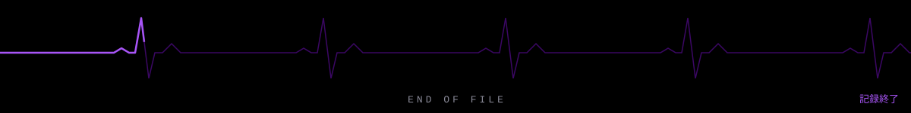

### ▚ DOSSIER &nbsp;個人記録

|  |  |
|:--|:--|
| **名前** &nbsp; NAME | Miguel |
| **職業** &nbsp; CLASS | Software Development Student |
| **専門** &nbsp; FOCUS | Web &amp; desktop applications |
| **状態** &nbsp; STATUS | `● ONLINE — building` |

<samp>Most of what's here is coursework, practice projects, and things I take apart to understand better.</samp>

### ▚ LOADOUT &nbsp;装備

  

### ▚ SIGNAL &nbsp;活動

### ▚ OFF-GRID &nbsp;私生活

`⌁ gym` &nbsp;&nbsp; `⌁ world of warcraft` &nbsp;&nbsp; `⌁ black and white photography`

### ▚ COMMS &nbsp;通信

